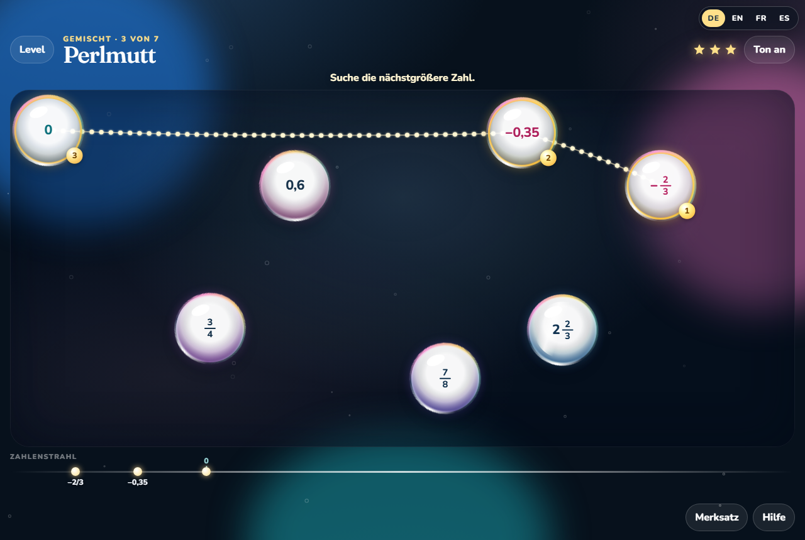

# Schimmerblasen

**[Direkt spielen](https://schwarzenbergg.github.io/schimmerblasen/Schimmerblasen.html)** öffnet die fertige Einzeldatei im Browser. Es ist nichts herunterzuladen.



Ein kleines Spiel für rationale Zahlen, etwa Klasse 6. In schimmernden Blasen erscheinen Dezimalzahlen, Brüche und gemischte Zahlen. Sie werden von der kleinsten zur größten verbunden. Eine Leuchtkette folgt den Blasen, und jede richtig gewählte Zahl setzt sich auf den Zahlenstrahl.

Erstellt mit Grok 4.7.

Die Seite gibt es auf Deutsch, Englisch, Französisch und Spanisch. Oben rechts stehen DE, EN, FR und ES. Die Wahl bleibt im Browser gespeichert. Beim ersten Öffnen gilt die Sprache des Browsers, wenn sie eine dieser vier ist, sonst Deutsch. Dezimalzahlen nutzen im Englischen den Punkt und sonst das Komma.

## Spielen

Die bearbeitbare Fassung liegt in mehreren Dateien. Unter Windows öffnet `start.bat` die Seite. Sonst die Datei `index.html` im Browser öffnen. Es braucht keine Installation. Für die Schriftarten der mehrteiligen Fassung ist beim ersten Mal eine Verbindung zu Google Fonts nötig. Danach spielt das Spiel ohne Netz.

Zum Verschicken gibt es [`Schimmerblasen.html`](https://schwarzenbergg.github.io/schimmerblasen/Schimmerblasen.html). In dieser einen Datei stecken Seite, Spiel und Schriftarten. Sie läuft offline, auch per Doppelklick, und über den Link oben direkt im Browser.

So geht eine Runde:

1. Einen Modus wählen: Dezimalzahlen, Brüche oder, wenn beide Abschlüsse geschafft sind, Perlmutt.
2. Die Blasen der Reihe nach antippen, von der kleinsten Zahl zur größten.
3. Merksatz zeigt den Hinweis zum Level, ohne einen Stern zu kosten. Hilfe hebt die nächste Blase hervor und kostet einen Stern. Jeder Fehler kostet ebenfalls einen Stern. Drei Sterne gibt es nur ohne Fehler und ohne Hilfe.

Mit `?alle=1` hinter der Adresse sind alle Level offen, auch Perlmutt. Beispiel: `index.html?alle=1`.

## Level

Dezimalzahlen: Seichte Lagune, Helle Bucht, Nahe Nachbarn, Spiegelwasser, Tiefenriff, Perlenwirbel, Gezeiten.

Brüche: Klare Tropfen, Stammbrüche, Bunte Nenner, Über eins, Unter null, Eng beieinander, Kronenriff.

Perlmutt mischt Dezimalzahlen, Brüche und gemischte Zahlen in einer Runde. Es öffnet sich, wenn Gezeiten und Kronenriff jeweils mindestens einen Stern haben.

Die Namen der Level sind in jeder Sprache eigene Lagunennamen. Die Aufgaben bleiben dieselben.

## Dateien

| Datei | Inhalt |
| --- | --- |
| `index.html`, `styles.css`, `i18n.js`, `logic.js`, `app.js` | die bearbeitbare Seite |
| `start.bat` | öffnet `index.html` unter Windows |
| `Schimmerblasen.html` | eine Datei zum Weitergeben, auch [direkt spielbar](https://schwarzenbergg.github.io/schimmerblasen/Schimmerblasen.html) |
| `docs/oberflaeche.png` | Bild der Spielfläche |
| `pack.py` | baut `Schimmerblasen.html` neu |

Nach einer Änderung an den Quelldateien die Einzeldatei neu bauen:

```bash
python pack.py
```

Das Skript übernimmt die schon eingebetteten Schriftarten und schreibt die Seite neu. Eine eigene Kopie mit „Kopie“ im Namen bleibt lokal und gehört nicht ins Repository.

## Schriftarten und Lizenz

Der Programmcode steht unter der MIT-Lizenz, siehe `LICENSE`. Die eingebetteten Schriftarten Fraunces und Nunito stehen unter der [SIL Open Font License 1.1](https://openfontlicense.org). Fraunces: Copyright 2018 The Fraunces Project Authors. Nunito: Copyright 2014 The Nunito Project Authors.

Die MIT-Lizenz ist für dieses öffentliche Repository gewählt, damit die Datei frei weitergegeben und verändert werden darf. Sie lässt sich austauschen, indem `LICENSE` ersetzt wird.

## English

Schimmerblasen is a grade-6 game: connect rational numbers from smallest to largest. Bubbles show decimals, fractions, and mixed numbers. The interface is in German, English, French, and Spanish.

[Play it](https://schwarzenbergg.github.io/schimmerblasen/Schimmerblasen.html) opens the single file in the browser. You can also open `index.html` from the source, or share `Schimmerblasen.html` offline. Add `?alle=1` to unlock every level. Game code is MIT. The embedded Fraunces and Nunito fonts stay under the SIL Open Font License 1.1.

Created with Grok 4.7.
